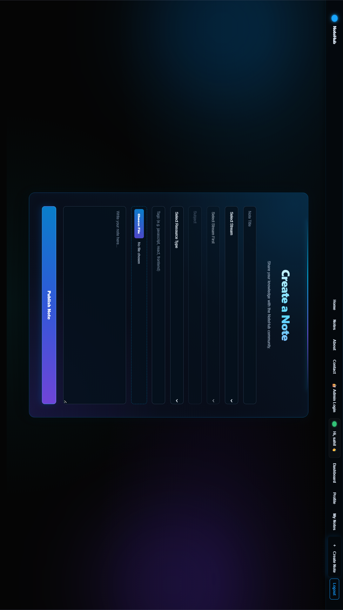
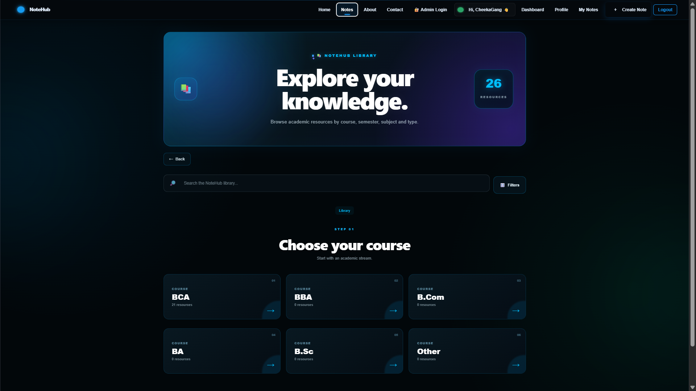
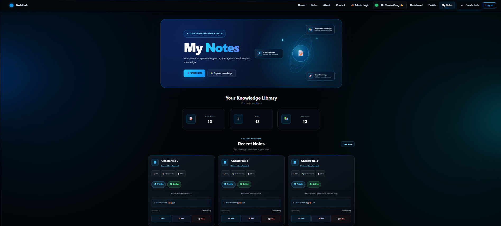
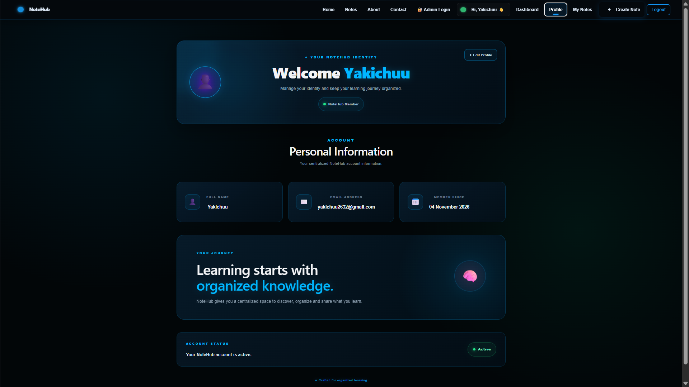
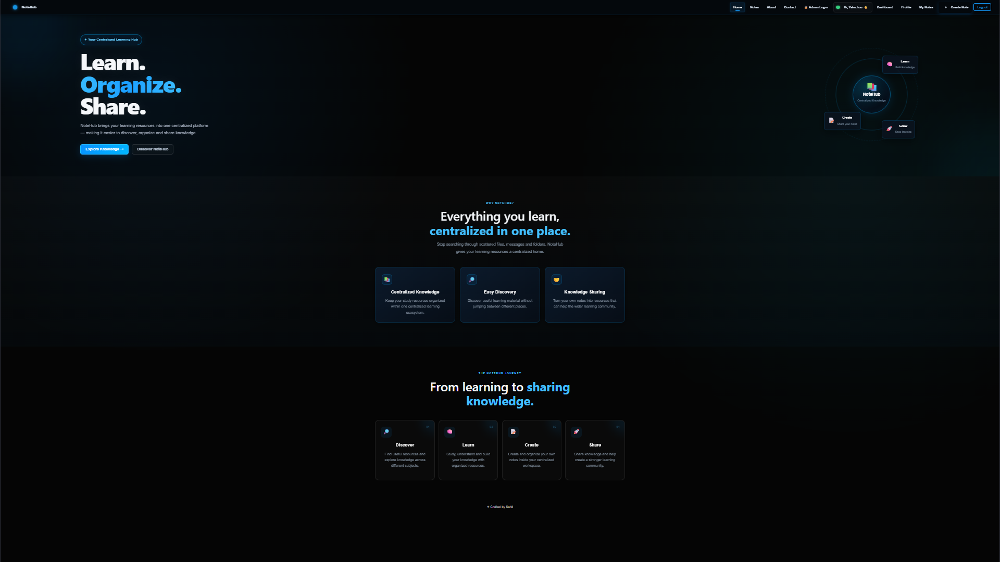
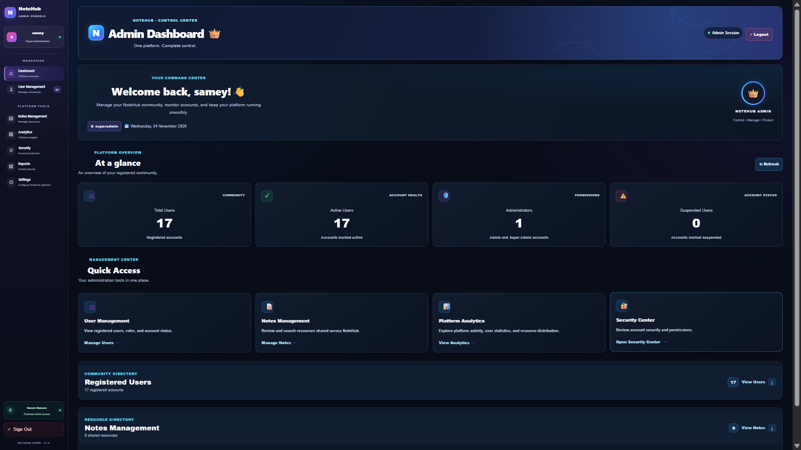

# 📚 NoteHub – Notes Sharing Platform

**NoteHub** is a full-stack web application designed to help students create, organize, manage, and share their study notes through a centralized platform.

It provides a simple and user-friendly interface where users can manage their notes, attach supporting documents, and access study resources efficiently.

---

## 🌐 Live Demo

**Frontend:** https://notehub-frontend-254v.onrender.com

**Backend:** https://notehub-0jad.onrender.com

---

## ✨ Key Features

- 🔐 **User Authentication** – Secure registration and login with JWT authentication.
- 📝 **Note Management** – Create, view, edit, and delete study notes.
- 🔍 **Search Functionality** – Easily search for notes.
- 👤 **My Notes** – Manage your own uploaded notes.
- 🌍 **Public & Private Notes** – Control the visibility of your notes.
- 📎 **File Attachments** – Upload, open, and download supporting documents.
- 🛡️ **Admin Panel** – Administrative tools for managing users and notes.
- 🚫 **Hide & Restore Notes** – Admin can hide and restore notes.
- 📱 **Responsive Design** – User-friendly interface across different screen sizes.

---

## 🛠️ Technology Stack

### Frontend
- React.js
- JavaScript
- HTML5
- CSS3

### Backend
- Node.js
- Express.js
- REST API

### Database
- MongoDB
- Mongoose
- MongoDB Atlas

### Authentication & Security
- JSON Web Token (JWT)
- bcrypt

### Tools & Deployment
- Visual Studio Code
- Git & GitHub
- Render

---

## 📸 Project Screenshots

Explore the user interface of NoteHub.

| About NoteHub | Create Note |
|:---:|:---:|
|  |  |

| Notes Page | My Notes |
|:---:|:---:|
|  |  |

| User Profile | Home Page |
|:---:|:---:|
|  |

| Admin Dashboard |
|:---:|


---

## ⚙️ Installation & Setup

Follow these steps to run NoteHub locally.

### 1. Clone the Repository

```bash
git clone https://github.com/CodeNexusLab/NoteHub.git
```

### 2. Navigate to the Project Directory

```bash
cd NoteHub
```

### 3. Backend Setup

```bash
cd backend
npm install
```

Configure the required environment variables in your backend `.env` file.

Example:

```env
PORT=5000
MONGO_URI=your_mongodb_connection_string
JWT_SECRET=your_jwt_secret
```

Start the backend server:

```bash
npm start
```

### 4. Frontend Setup

Open another terminal:

```bash
cd frontend
npm install
npm run dev
```

The frontend will start using the local Vite development server.

---

## 📁 Project Structure

```text
NoteHub/
│
├── backend/
│   ├── models/
│   ├── routes/
│   ├── middleware/
│   ├── server.js
│   └── package.json
│
├── frontend/
│   ├── public/
│   ├── src/
│   │   ├── components/
│   │   ├── App.jsx
│   │   ├── App.css
│   │   └── api.js
│   └── package.json
│
└── README.md
```

---

## 🚀 Future Improvements

- AI-powered Notes Summarization
- AI Question Generator
- AI Flashcards
- Advanced Search and Filters
- Bookmarks and Note Sharing
- Comments and User Interaction

---

## 👨‍💻 About the Developer

**Sahil**

BCA Student | Aspiring Full Stack Web Developer

Interested in building practical web applications and exploring modern web technologies.

**GitHub:** https://github.com/CodeNexusLab

---

## 📄 License

This project is developed for educational and learning purposes.

---


